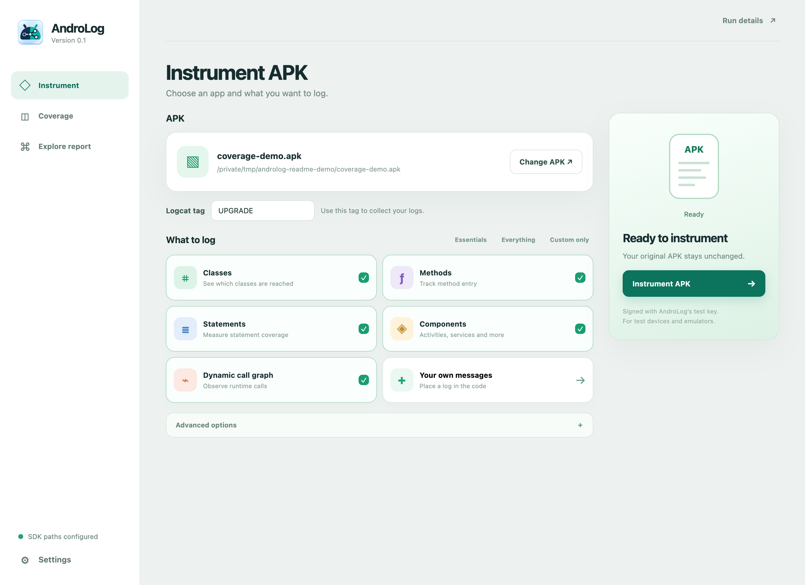
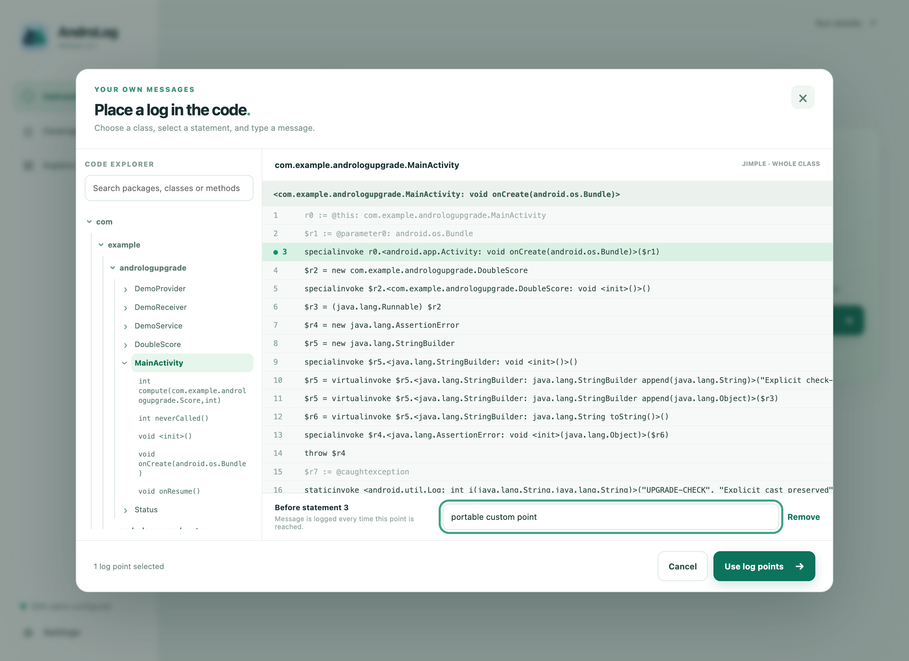
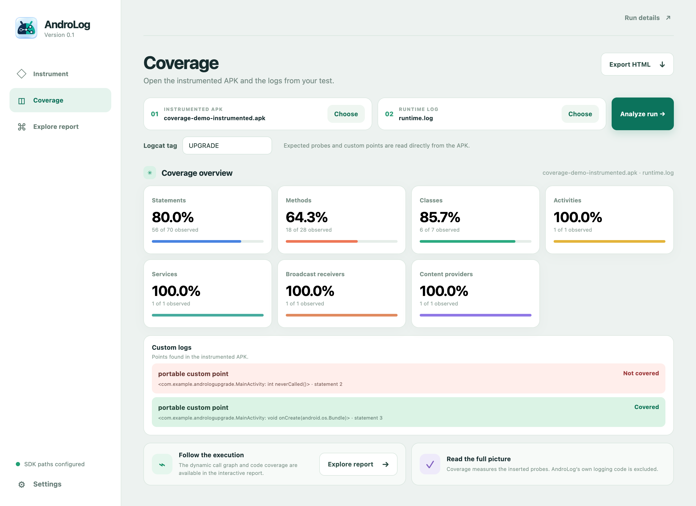
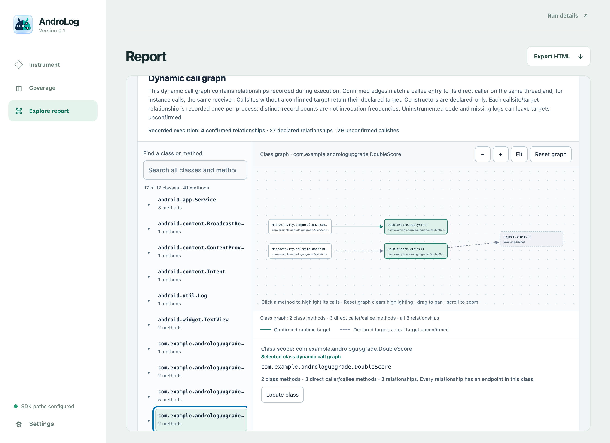

<p align="center">
  
</p>

# AndroLog

**Instrument Android apps. See what ran. Explore the code.**

AndroLog adds logging probes to APKs and turns runtime logs into coverage statistics and dynamic call graphs. Choose automatic probes or place your own messages in the code. No application source code is needed.

[Install](#install-and-launch) · [GUI walkthrough](#use-androlog) · [Desktop guide](electron-gui/README.md) · [CLI guide](docs/cli.md) · [Wiki](https://github.com/JordanSamhi/AndroLog/wiki)

## Install and launch

To run from source, install:

- **JDK 17+ and Maven** for the Java backend.
- **Node.js 22.12+ and npm** for the desktop interface.
- **Android SDK** with Platforms, Build Tools, and Platform Tools (`adb`).

```bash
git clone https://github.com/JordanSamhi/AndroLog.git
cd AndroLog
mvn package
cd electron-gui
npm ci
npm start
```

In **Settings**, choose your SDK's `platforms` folder and one `build-tools/<version>` folder. Java is detected automatically. For later launches, run `npm start` from `electron-gui`.

The Electron GUI targets macOS, Windows, and Linux. You can also [build a desktop package](electron-gui/README.md#package-for-your-platform) with Java included.

## Use AndroLog

### 1. Choose what to log

Open the **original APK** in **Instrument**. Select classes, methods, statements, Android components, or **Dynamic call graph**, then click **Instrument APK** and save the result.

[](data/screenshots/gui-instrument.png)

Want a message at one specific point? Open **Your own messages**, browse the package → class → method tree, select a statement, and type a message such as `reached this point`.

<details>
<summary>See custom log selection</summary>

[](data/screenshots/gui-custom-logs.png)

The code browser shows Jimple reconstructed from the APK. Messages are literal text, emitted whenever the selected point is reached.

</details>

### 2. Run the app

After saving, **Run your app** shows the `adb install` and Logcat commands for your APK, each with a **Copy** button. Install on a test device or emulator, start capture, then launch and exercise the app. Stop capture with **Ctrl+C**.

The GUI reads log files. For automatic installation, launch, and capture, use the CLI's [`--capture` option](docs/cli.md#automatic-capture).

### 3. Analyze coverage

In **Coverage**, open the **instrumented APK used for the test** and its **log file**, enter the matching Logcat tag, then click **Analyze run**. The dashboard shows statements, methods, classes, and Android components observed during the run.

[](data/screenshots/gui-coverage.png)

Custom logs show their location and a green **Covered** or red **Not covered** marker. Click one to jump to its statement. Red means not observed in this capture, not necessarily unreachable.

**The instrumented APK and its logs are enough to analyze a run on another computer.** No original APK or local instrumentation history is required. AndroLog's added code is excluded from the statistics.

### 4. Explore and share

**Explore report** lets you browse packages and methods, read whole classes with coverage highlighting, and follow code references. The **dynamic call graph** shows recorded calls; selecting a node highlights its incoming and outgoing edges.

[](data/screenshots/gui-dynamic-graph.png)

Use **Export HTML** to share an interactive report that opens offline in a browser. Screenshots use a test APK and sample logs; custom-log statuses are illustrated with controlled observations.

## Command line

The same Java backend also supports instrumentation, automatic capture, and HTML/JSON reports:

```bash
java -jar target/androlog-0.1-jar-with-dependencies.jar --help
```

See the [CLI guide](docs/cli.md) for signing setup, examples, options, and coverage semantics. The [desktop guide](electron-gui/README.md) covers SDK setup, custom logs, packaging, and troubleshooting.

## Contributing and license

AndroLog uses [AndroSpecter](https://github.com/JordanSamhi/AndroSpecter) and Soot for instrumentation and bytecode analysis. [Issues and pull requests](https://github.com/JordanSamhi/AndroLog/issues) are welcome; see the [development checks](electron-gui/README.md#development-checks) before submitting changes.

Licensed under [LGPL v2.1](LICENSE). Contact: [Jordan Samhi](mailto:j.samhi@me.com).
