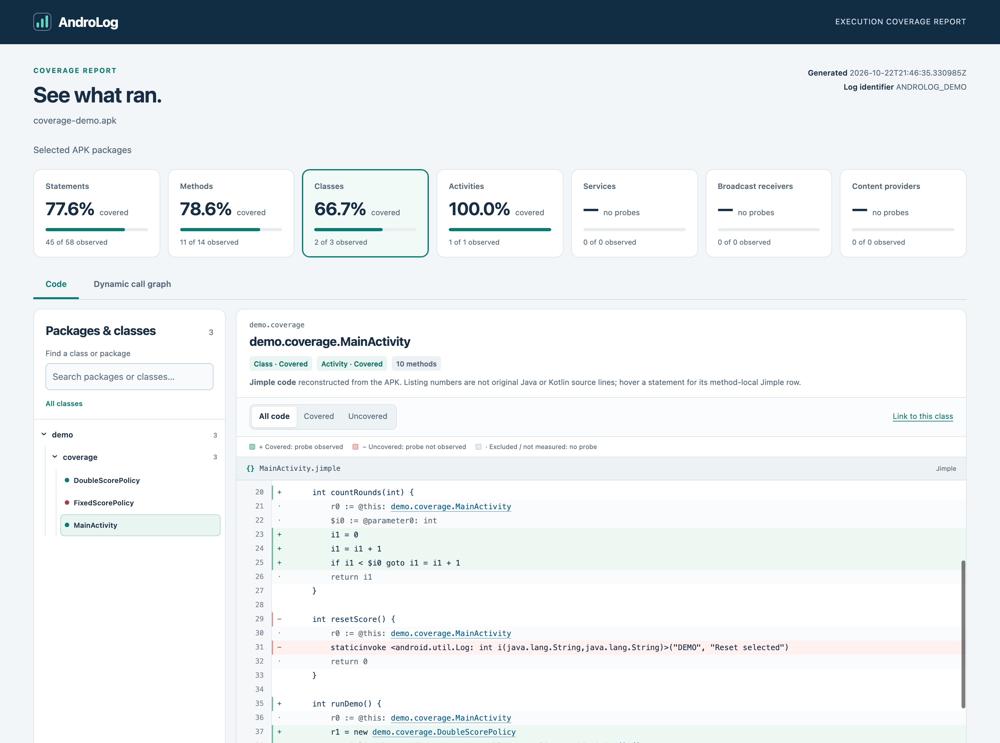
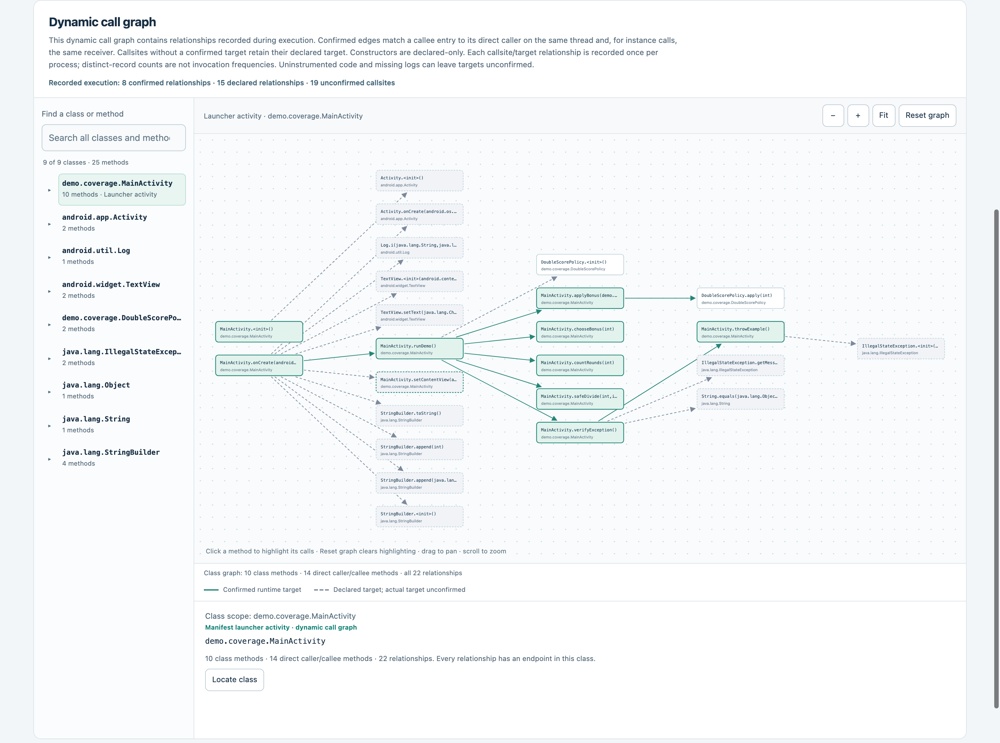

<p align="center">
  
</p>

# AndroLog

**Instrument Android APKs, measure runtime code coverage, and explore dynamic call graphs.**

AndroLog inserts logging probes into an APK, then compares the original application with logs collected while the instrumented app runs. It works from APK bytecode; application source code is not required.

- **Coverage:** classes, methods, statements, activities, services, broadcast receivers, and content providers.
- **Dynamic call graphs:** executed callsites and confirmed runtime dispatch targets, including virtual and interface calls.
- **Interactive HTML reports:** package navigation, continuous class listings, coverage filters, clickable code references, and class-level graph exploration.
- **Terminal and JSON reports:** aggregate coverage and cumulative coverage by minute.
- **Integrated capture:** install and launch the instrumented app, collect logs, and generate reports with one command.
- **Desktop GUI:** instrument an APK, place custom logs in its code, compare runtime logs with the original APK, and explore the results in one window.
- **Custom log points:** write a message at a selected statement, see whether it was reached, and jump directly to that location in the report.

[Wiki](https://github.com/JordanSamhi/AndroLog/wiki) · [Desktop GUI](#desktop-gui) · [Previews](#report-previews) · [Setup](#build-and-configure) · [Quick start](#instrument-run-and-report) · [Reports](#read-the-reports) · [Dynamic call graph](#dynamic-call-graph) · [Options](#command-line-reference) · [Troubleshooting](#troubleshooting)

The [AndroLog wiki](https://github.com/JordanSamhi/AndroLog/wiki) provides complete user and developer guides, including capture workflows, report navigation, coverage semantics, dynamic dispatch, JSON/log formats, and troubleshooting.

## Report previews

These screenshots show a report generated from an instrumented Android demo app running on an emulator. Click either image to view it at full resolution.

**Coverage explorer:** browse packages, open a whole class, and see covered statements in green and unobserved statements in red.

[](data/screenshots/coverage-report.png)

**Dynamic call graph:** explore the launcher activity's recorded calls. Solid edges show confirmed runtime targets; dashed edges retain declared targets when dispatch was not confirmed.

[](data/screenshots/dynamic-call-graph.png)

## Requirements

| Dependency | Used for |
| --- | --- |
| JDK 17 or newer and Apache Maven | Building the Java backend. Source runs and the CLI need Java; packaged desktop apps bundle a runtime. |
| Node.js 22.12 or newer and npm | Running or packaging the Electron desktop GUI from source, and running its tests. Not needed for the Java CLI or a packaged app. |
| Android SDK Platforms | Resolving Android classes during instrumentation and report generation. Install a platform containing `android.jar`. |
| Android SDK Build Tools | Aligning and signing instrumented APKs with `zipalign` and `apksigner`. |
| Android SDK Platform Tools (`adb`) and a device or emulator | Installing the instrumented APK and collecting runtime logs. |
| A browser | Opening the standalone HTML report offline. |

The desktop interface targets macOS, Windows, and Linux. macOS packaging has been tested; Windows and Linux packages still need validation on those systems.

AndroLog uses AndroSpecter 2.0.0 with Soot 4.6.0 pinned for APK compatibility. The transitive Soot 4.7.1 backend caused constructor and register-verification failures in Word Snake runtime checks. Keep the Soot pin when rebuilding; upgrading it requires testing the resulting APKs on Android, as compilation alone does not catch these failures.

## Build and configure

### Build from source

```bash
git clone https://github.com/JordanSamhi/AndroLog.git
cd AndroLog
mvn package
```

The executable JAR, including dependencies, is written to:

```text
target/androlog-0.1-jar-with-dependencies.jar
```

Check the available options:

```bash
java -jar target/androlog-0.1-jar-with-dependencies.jar --help
```

## Desktop GUI

The desktop app uses Electron for the interface and the same Java engine as the CLI. Its three views are **Instrument**, **Coverage**, and **Explore report**.

### Install and launch from source

After building the Java backend with `mvn package`, run:

```bash
cd electron-gui
npm ci
npm start
```

These commands work on macOS, Windows, and Linux with the requirements above. For later launches, run `npm start` from `electron-gui`; rebuild with `mvn package` from the repository root after changing the Java backend. The desktop app does not require the CLI signing configuration below.

Open **Settings** and check the automatically discovered Android SDK paths:

| Setting | What to select |
| --- | --- |
| **Android SDK platforms** | The SDK's `platforms` folder, containing at least one `android-<version>/android.jar`. Required for reading APKs and generating reports. |
| **Android Build Tools** | One installed `build-tools/<version>` folder containing `zipalign` and `apksigner`. Required for instrumenting and signing APKs. |
| **Java executable** | Usually leave empty. Source runs use `JAVA_HOME` or Java on `PATH`; packaged apps use their bundled runtime. Choose an executable to override it. |

Install missing SDK packages with Android Studio's SDK Manager or Android's SDK command-line tools. Settings and custom-point metadata stay in the application's local user-data directory, outside the repository.

### Instrument, run, and explore

1. **Instrument:** choose the original APK and a Logcat tag. Select classes, methods, statements, components, or **Dynamic call graph**. **Essentials** selects classes, methods, and components; **Everything** enables all five. Optional package and library filters are under **Advanced options**.
2. **Add custom messages, if needed:** open **Your own messages**, expand packages → classes → methods, select a statement in the whole-class listing, and type a message such as `reached this point`. Click **Use log points**. **Custom only** disables automatic probes while keeping your messages.
3. **Save and run:** click **Instrument APK**, then **Save instrumented APK**. AndroLog leaves the original APK unchanged and signs the output with its test key. The window then shows `adb install` and Logcat commands using your saved filename and tag. Start capture before launching the app in a fresh process, exercise it, and stop capture with **Ctrl+C**.
4. **Coverage:** choose the **original APK** and the **runtime log**. Keep the same tag, automatic probes, package prefix, and library filter used for instrumentation, then click **Analyze run**. Cards show observed/total classes, methods, statements, and Android components. Custom logs show their message, location, and a green **Covered** or red **Not covered** status.
5. **Explore report:** browse packages and methods, scroll through a whole class, follow code links, and inspect the dynamic call graph. Custom messages appear beside their statements with green/red markers. Clicking a custom log in Coverage jumps to that statement here. Use **Export HTML** to save a standalone report.

**The coverage baseline is the original APK.** The only analysis inputs to select are that APK and its log file; there is no APK-build selector. Custom-point locations are recovered automatically from metadata saved when this GUI instruments the APK. If that metadata is missing or ambiguous, AndroLog shows the observations it can identify instead of guessing which points were missed.

Custom messages are literal single-line text, emitted immediately before the selected statement on every visit. They do not evaluate variables, and they can be used independently of automatic coverage probes. A red marker means the point was not observed in the supplied log; a late or incomplete capture can miss execution.

The GUI currently reads captured log files; it does not record a device session itself. For installation, launch, capture, and reporting in one command, use the CLI's [`--capture` workflow](#automatic-capture). See the [desktop guide](electron-gui/README.md) for a complete walkthrough and troubleshooting.

### Create a packaged desktop app

From `electron-gui`, after `mvn package` has built the backend:

```bash
npm ci
npm run dist
```

Build on the target operating system and architecture, using a full JDK 17+ with `jlink` and a matching architecture. Archives are written to `target/electron/`: a ZIP on macOS and Windows, or a `.tar.gz` on Linux. Extract the archive and launch AndroLog. The package includes Electron and Java, so users do not need Node.js, Maven, or a separate Java installation. Android SDK packages are still required.

The default macOS package is ad-hoc signed for local testing, not a notarized public installer. See [packaging details](electron-gui/README.md#package-for-your-platform) for distribution and local app-image builds.

### Earlier Java GUI

The earlier Swing interface remains in the source tree. After `mvn package`, launch it with `./androlog-gui` (`androlog-gui.bat` on Windows) or `java -jar target/androlog-gui-0.1.jar`. These launchers open the Java interface; use `npm start` above for the current Electron GUI.

## Configure command-line APK signing

APK instrumentation requires the paths to your own Android SDK signing tools. Report generation does not invoke these tools.

Keep machine-specific configuration outside the checkout. Create the directory:

```bash
mkdir -p "$HOME/.config/androlog"
```

Create `$HOME/.config/androlog/config.properties` with the following content, replacing both paths with executables from an installed Build Tools version:

```properties
zipalignPath=/absolute/path/to/Android/sdk/build-tools/VERSION/zipalign
apksignerPath=/absolute/path/to/Android/sdk/build-tools/VERSION/apksigner
```

Use absolute paths without surrounding quotes. Java properties do not expand `~` or shell variables such as `$HOME`.

Define this helper in your terminal, from the repository root. The configuration directory comes first on the classpath, so it overrides the bundled configuration:

```bash
androlog() {
  java -cp "$HOME/.config/androlog:target/androlog-0.1-jar-with-dependencies.jar" \
    com.jordansamhi.androlog.Main "$@"
}
```

The examples below use this helper in the same terminal. The shell examples use Bash/Zsh syntax and the Unix classpath separator (`:`).

Alternatively, configure `src/main/resources/config.properties`, rebuild, and run with `java -jar`. That file is tracked: do not commit local SDK paths. A JAR built with those paths also contains them; the external configuration above avoids embedding them in the JAR.

## Instrument, run, and report

The workflow is: **instrument an APK → exercise it on a device → collect logs → report against the original APK**.

Run these commands from the repository root. Set the two input paths for your environment:

```bash
androlog_sdk="/absolute/path/to/Android/sdk"
androlog_apk="/absolute/path/to/app.apk"
```

### Automatic capture

With a device or emulator connected, run the complete workflow with `--capture`:

```bash
androlog \
  -a "$androlog_apk" -p "$androlog_sdk/platforms" \
  -o ./out -l ANDROLOG \
  -c -m -s -cp -mc --capture
```

AndroLog instruments and signs the APK, installs it, starts log capture, and launches its manifest-declared launcher activity. Exercise the app on the device, then **press Enter in the terminal** to stop capture and generate the HTML and JSON reports, including a cumulative timeline.

Each run creates a fresh `out/capture-…/` session directory containing the instrumented APK under `instrumented/`, `runtime.log`, `coverage.html`, and `coverage.json`. Full build and report diagnostics are saved as `instrumentation.log` and `report-generation.log`. Use `-html` and `-j` to override the report destinations. Probe and scope options are reused automatically for reporting.

- Add `--device <serial>` when more than one device is connected. List devices with `adb devices`.
- Add `--duration 60` for a timed capture instead of waiting for Enter. The timer starts after launch; launch-time observations are included. Use this option when running without interactive input.
- Add `--adb /absolute/path/to/adb` if needed. Otherwise, AndroLog looks in the SDK associated with `-p`, then `ANDROID_HOME`, `ANDROID_SDK_ROOT`, and `PATH`.

Capture restarts the target app so its initial probes are recorded. It waits for logcat readiness before launch and excludes older buffered records without clearing the device's logs. Launcher aliases are supported. If the APK declares several launchers, the first sorted by target class and component name is used.

Installation uses `adb install -r`; a signing mismatch is reported without uninstalling the app. **Ctrl+C aborts the workflow and keeps the raw log**; it does not generate reports. A device disconnection or capture failure also keeps the partial log, which can be parsed later with the original APK, log tag, and probe/scope options. `--capture` cannot be combined with `-pa` or `-pam`.

To manage installation and log collection yourself, follow the three manual steps below.

### 1. Instrument the APK

This example enables all coverage categories and dynamic call tracing:

```bash
androlog \
  -a "$androlog_apk" -p "$androlog_sdk/platforms" \
  -o ./out/instrumented -l ANDROLOG \
  -c -m -s -cp -mc
```

AndroLog writes an aligned, signed APK to `out/instrumented/`, using the input APK's filename. The original APK stays unchanged. The output uses the bundled test signing key, so use a test device or emulator where it will not conflict with an installation signed by the original publisher.

Select only the probes you need. For example, use `-m` for method coverage or `-mc` alone for a dynamic-call-graph-only run. Adding `-pkg com.example.app` selects that exact package and its subpackages, excluding similarly named packages such as `com.example.application`; a trailing dot is accepted and normalized. This scope applies consistently to all probes and reports. `-n` excludes known libraries.

### 2. Install the APK and capture a test run

```bash
adb install -r "./out/instrumented/$(basename "$androlog_apk")"
adb logcat -c
adb logcat -v threadtime ANDROLOG:D '*:S' > ./out/runtime.log
```

`adb logcat -c` clears the device's existing log buffers for this capture. Leave the last command running, then launch the app and exercise the behavior you want to measure. Stop capture with **Ctrl+C** when finished.

Start capture before launching a fresh app process. Some probes and call records are emitted only once per process, so starting capture after the app has already run can miss them. Use the same tag in the logcat filter and AndroLog's `-l` option.

### 3. Generate the reports

Use the **original APK**, the same log tag, and the same probe and scope options used for instrumentation:

```bash
androlog \
  -a "$androlog_apk" -p "$androlog_sdk/platforms" \
  -l ANDROLOG -c -m -s -cp -mc \
  -pa ./out/runtime.log \
  -html ./out/reports/coverage.html \
  -j ./out/reports/coverage.json
```

| Output | Contents |
| --- | --- |
| Terminal | Coverage totals and dynamic call graph statistics, with or without file outputs. |
| `out/reports/coverage.html` | A standalone report with embedded data and scripts. Open it locally in a browser; no server or network connection is needed. |
| `out/reports/coverage.json` | Structured coverage totals and the full recorded dynamic call graph. |

Report directories are created automatically. Keep the APK version, tag, probes, and scope (`-pkg` and `-n`, if used) consistent between instrumentation and reporting.

To include a cumulative timeline, replace `-pa ./out/runtime.log` with `-pam ./out/runtime.log`. Use one parsing mode at a time. HTML and JSON output options require `-pa`, `-pam`, or `--capture`.

## Read the reports

### Explore coverage

The HTML report provides:

- An expandable **package tree** for choosing classes.
- One continuous **class listing**, with inline method declarations and a single scrollbar.
- Filters for **all, covered, or not-observed statements**.
- Links to classes, fields, methods, and constructors present in the report. Browser Back and Forward follow navigation history.
- Clickable statistics: component cards filter the class list; **Methods** adds an exact method selector; **Statements** selects classes with measured statements. Search works within the selected category.

**Classes** returns to class browsing. **Show all classes** also clears the search. Components that were not observed remain selectable.

The listing uses **Jimple**, Soot's intermediate representation of APK bytecode. Its line numbers identify the reconstructed listing, not the original Java or Kotlin source. Statement tooltips show their position within each method. Following a code reference switches to **All code** so the destination is visible.

### Interpret coverage states

| Statement state | Meaning |
| --- | --- |
| Covered | The matching probe was observed in the supplied logs. |
| Not observed | The baseline contains a probe, but its log was not observed. |
| Excluded | Identity, return, and monitor statements are excluded from statement instrumentation. |
| Not measured | Statement coverage was not selected, or the statement has no matching baseline probe. |

Use `-s` in both stages for statement coverage and `-m` for method coverage. Class and Android component coverage are measured by their own probes; one does not automatically imply the other. Terminal percentages display `n/a` when the denominator is zero.

Statement probes run **before** eligible statements, including branches, jumps, and operations that may throw. Covered means execution reached the statement; it does not imply that the statement completed successfully. Incoming branches pass through the destination's probe, and exception handlers keep their required caught-exception identity first. Missing logs can still leave executed statements marked as not observed.

APKs instrumented with older versions used after-statement probes. Reinstrument the original APK and collect fresh logs to benefit from the improved coverage. Existing logs remain readable, with their original measurement limitations.

### Interpret the timeline and JSON

With `-pam`, each distinct probe contributes to the timeline in the minute of its first matching log entry. The timeline accumulates newly observed probes, rather than counting repeated executions. Matching observations without usable timestamps still contribute to aggregate totals but cannot appear on the timeline.

AndroSpecter 2.0.0 includes the callback signature in component messages, for example `ACTIVITY=com.example.MainActivity|void onResume()`. AndroLog counts each component class once, regardless of how many callbacks were observed, and continues to accept older class-only component messages. After upgrading the analysis dependencies, reinstrument the original APK and collect fresh logs: statement identities can change with the Soot version.

JSON reports contain `coverageSummary`; `-pam` also adds `perMinuteSummaries`. When call tracing is requested or call records are available, `callGraph` contains the recorded nodes, edges, callsite metadata, statistics, and manifest-derived `launcherActivities`.

## Dynamic call graph

Enable **`-mc` when instrumenting**, install that APK, and collect a new log. Coverage-only logs cannot provide dynamic dispatch targets. Keep `-mc` enabled when generating the report.

### Navigate the graph

The graph opens on the **launcher activity's class graph**, identified from the APK manifest's `MAIN` and `LAUNCHER` intent filter, or `LEANBACK_LAUNCHER` for TV. Activity aliases resolve to their target classes. If several launcher classes have recorded calls, the first in alphabetical order opens. Launcher classes appear first in the sidebar.

- **Select a class** to see its recorded methods and their direct incoming and outgoing relationships. Callers and callees from other classes appear as endpoints; unrelated relationships are excluded.
- **Click a node** to highlight its incoming and outgoing edges and fade the others. All nodes, edges, positions, zoom, and pan remain in place.
- **Reset graph** clears the highlighting; **Fit** fits the current class graph to the canvas.
- **Select an edge** to inspect its callsites. **Open code** jumps to a method's listing when its code is available.

Search covers all recorded classes and methods. If launcher metadata or matching calls are unavailable, the report asks you to select a class; it never falls back to showing the entire application graph by default.

### Understand the edges

| Edge | Meaning |
| --- | --- |
| Solid: confirmed runtime target | A matching instrumented method entry established the actual target. A call declared as `Base.work()` may resolve to `Child.work()`, or to different overrides across runs. |
| Dashed: declared target | The callsite was reached, but no target entry was confirmed. The edge retains the bytecode target. |

Runtime matching uses the same thread, exact method subsignature, receiver identity for instance calls, and direct caller stack. It supports nested calls, recursion, and exceptional returns. It does not pair a call with the next log line.

Constructors, dynamic invokes, and calls into uninstrumented code remain declared-only. A declared edge can also represent a call that failed before entering its target, such as a null receiver. Reflection, framework callbacks, asynchronous work, and uninstrumented intermediaries are not inferred as direct edges. Legacy `CALL=` records can be displayed as declared-only edges but cannot recover actual dispatch targets.

Each callsite declaration and callsite/actual-target pair is logged once per process. **Counts are distinct records, not invocation frequencies.** The graph describes observations in the supplied logs; it is not a complete static call graph.

Call tracing captures stack traces and adds runtime overhead. Limit scope with `-pkg` or `-n` where appropriate. Complete `MC2` records avoid pairing unrelated log lines, and duplicate records are ignored when logs are merged. Missing logs can still leave relationships absent or unconfirmed. `-mc` can be combined with statement coverage: callsites are captured before coverage instrumentation to preserve the original statement identities.

## Command-line reference

```bash
java -jar target/androlog-0.1-jar-with-dependencies.jar --help
```

`-a` and `-p` are required except when displaying help. Without `-pa`, `-pam`, `--capture`, or `--inspect-code`, AndroLog instruments the APK and exits.

### Inputs and outputs

| Option | Description |
| --- | --- |
| `-a`, `--apk <file>` | Input APK. Use the original APK when reporting. |
| `-p`, `--platforms <path>` | Android SDK platforms directory or Android platform file (`android.jar`). |
| `-o`, `--output <directory>` | Destination for the instrumented APK, or parent directory for a fresh capture session. Defaults to a temporary directory. |
| `-l`, `--log-identifier <tag>` | Logcat tag. Defaults to `ANDROLOG`. |
| `-pa`, `--parse <file>` | Parse a runtime log and report aggregate coverage. |
| `-pam`, `--parse-per-minute <file>` | Parse a runtime log and include cumulative coverage by minute. |
| `-html`, `--html <file>` | Write a standalone HTML report. Requires `-pa`, `-pam`, or `--capture`. |
| `-j`, `--json <file>` | Write a JSON report. Requires `-pa`, `-pam`, or `--capture`. |
| `--inspect-code <file>` | Export the original Jimple statements to a JSON catalog without changing or signing the APK. |
| `--custom-logs <file>` | Instrument the exact points in an APK-bound JSON plan. May be used alone or with automatic probes; cannot be combined with capture or reporting. |
| `--custom-report-only` | Allow an HTML code report without automatic coverage probes. Requires `-pa` or `-pam` and `-html`; used by the GUI for custom-only runs. |

### Capture

| Option | Description |
| --- | --- |
| `-capture`, `--capture` | Instrument, install, launch, capture logs, and generate HTML/JSON reports. Select at least one probe option. |
| `-device`, `--device <serial>` | Device or emulator to use. Required when multiple devices are online. Capture only. |
| `-adb`, `--adb <path>` | ADB executable. Discovered from the SDK or `PATH` by default. Capture only. |
| `-duration`, `--duration <seconds>` | Positive capture duration after launch. Otherwise, press Enter to finish. Capture only. |

Capture log tags may contain letters, digits, underscores, dots, and hyphens, and must start with a letter, digit, or underscore.

### Probes

| Option | Measures |
| --- | --- |
| `-c`, `--classes` | Classes. |
| `-m`, `--methods` | Methods. |
| `-s`, `--statements` | Eligible Jimple statements. |
| `-cp`, `--components` | Activities, services, broadcast receivers, and content providers. |
| `-mc`, `--method-calls` | Executed callsites and confirmed runtime targets. |

Select the same probes for instrumentation and reporting. `--capture` requires at least one probe option. HTML reports also require a probe unless `--custom-report-only` is set; `-mc` alone supports a graph-only report.

### Scope and diagnostics

| Option | Description |
| --- | --- |
| `-pkg`, `--package <prefix>` | Select the exact package and its subpackages; a trailing dot is normalized. |
| `-n`, `--non-libraries` | Exclude known libraries. Bundled libraries are included by default. |
| `-t`, `--threads <count>` | Positive Soot thread count. Defaults to Soot's configuration. |
| `-v`, `--verbose` | Include exception details when a run fails. |
| `-h`, `--help` | Show usage and examples. |

The CLI prints timed stages and generated file paths. Errors go to standard error. Exit codes are `0` for success, `1` for processing failures, and `2` for invalid arguments.

## Troubleshooting

| Symptom | What to check |
| --- | --- |
| GUI cannot read the APK or find signing tools | In **Settings**, choose the SDK `platforms` folder and an installed `build-tools/<version>` folder. Use **Run details** for the backend error. |
| `Signing tool not configured` or tool not executable in the CLI | Check both paths in your external `config.properties` and use the classpath helper. The files must exist and be executable. |
| Installation fails with `INSTALL_FAILED_UPDATE_INCOMPATIBLE` | The installed app and instrumented APK have different signing certificates. Use a clean test device or emulator installation. |
| Coverage is unexpectedly empty or incomplete | Check the original APK version, log tag, probe flags, and scope. Capture before starting a fresh app process and exercise the relevant code. |
| No dynamic call graph is available | Enable **Dynamic call graph** in the GUI or instrument with `-mc`, install that APK, and capture a new log. Enabling it only during analysis cannot create missing runtime observations. |
| The graph asks you to choose a starting class | The launcher activity has no matching recorded calls, the app has no launcher declaration, or an older report lacks manifest metadata. Select a class or regenerate the report from the APK. |
| No timeline entries appear | Use `-pam` with timestamped output such as `adb logcat -v threadtime`. Untimestamped observations count only toward aggregate totals. |
| Capture cannot select a device | Check `adb devices`, authorize the connection, and use `--device <serial>` if several devices are online. |
| Capture reports that standard input closed | Use `--duration <seconds>` in non-interactive runs. The raw log is retained in the session directory. |
| Logcat stops or the device disconnects | Reconnect the device and start a new capture. The partial log remains available for manual reporting. |

For other failures, repeat the command with `-v` to include exception details.

## Development and contributions

AndroLog uses [AndroSpecter](https://github.com/JordanSamhi/AndroSpecter) for instrumentation support and Soot for bytecode analysis. Maven manages the Java build and dependencies.

Run the Java tests:

```bash
mvn test
```

Run the Electron GUI tests after `npm ci` in `electron-gui`:

```bash
cd electron-gui
npm test
```

From the repository root, run the report's JavaScript regression tests:

```bash
node --test src/test/js/report-links.test.js src/test/js/report-graph.test.js
```

Issues and pull requests are welcome. For a bug report, include the command, Java and Android SDK versions, the relevant error output, and a minimal reproducible example when possible. Use the [issue tracker](https://github.com/JordanSamhi/AndroLog/issues).

## License and contact

AndroLog is licensed under the **GNU Lesser General Public License v2.1**. See [LICENSE](LICENSE).

For questions, contact [Jordan Samhi](mailto:j.samhi@me.com).
